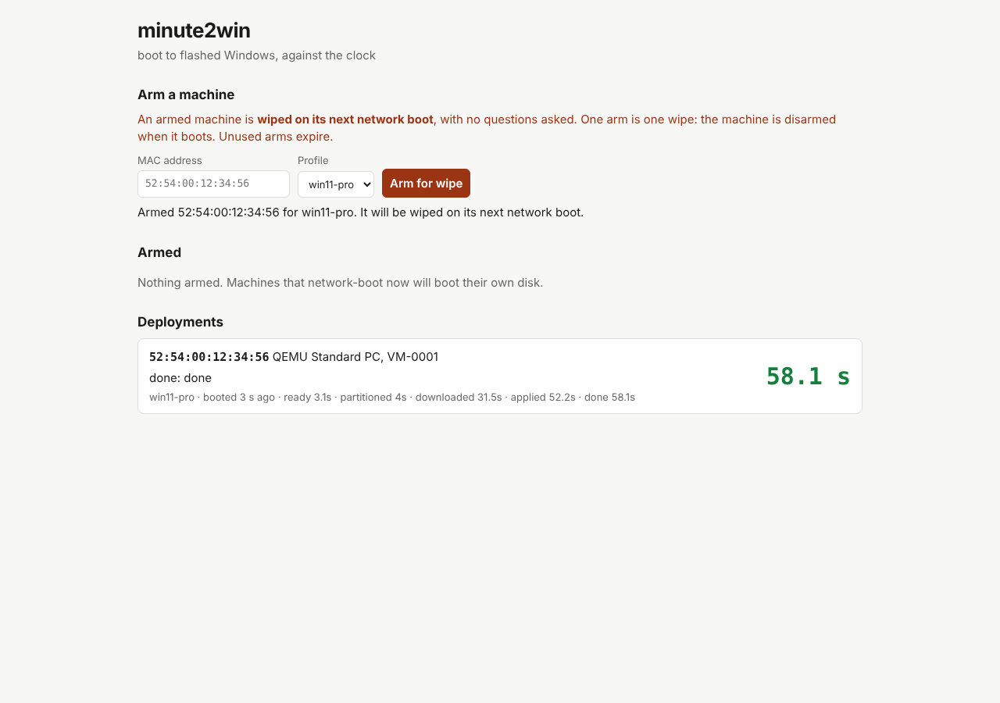

# minute2win

**Arm a machine. Network boot it. Install Windows.**

The source also includes **experimental Debian, Ubuntu Server, Proxmox-through-Debian and Bazzite AMD/Intel KDE profiles**. They use the same arm-and-reboot workflow with distro-native installers. See the [Linux setup guide](docs/LINUX.md). Linux has automated server and disk-policy tests; the [Bazzite VM validation record](docs/validation/2026-11-14-bazzite.md) separates native install/boot evidence from remaining hardware limits.

You type a machine's MAC address into a web page and pick a Windows profile. The next time that machine network boots, it wipes its disk, installs a fresh, verified copy of Windows and reboots into it. You can watch each phase tick by on a live board. Want it brand new again later? Arm it and reboot. That's the whole loop.

[Download](https://github.com/spilloid/minute2win/releases) · [First deployment, step by step](docs/WALKTHROUGH.md) · [Getting started](docs/GETTING_STARTED.md) · [All docs](docs/guide.md) · [Product page](https://spilloid.github.io/minute2win/) · [What's verified](docs/STATUS.md)



*Demo data from the automated UI test. The MAC, the QEMU machine and the 58.1 s lap times are fixtures, not a measured deployment.*

> **Heads up: arming a machine means "wipe it".** When an armed machine boots, minute2win erases its internal disk without asking again. That's on purpose, so no one has to stand at the machine. Try it on a throwaway virtual machine first, and double-check every MAC you arm.

## Is this for me?

minute2win is for you if you reimage Windows PCs regularly (a lab, a repair bench, a classroom) and want it to be one click and a reboot instead of a USB stick and twenty minutes of clicking through setup.

The current version is **0.5.0**. Here's honestly where Windows deployment stands:

- **Works:** the whole chain has run end to end on a disposable UEFI virtual machine: network boot, imaging, booting the new Windows, and the first-boot setup script.
- **Tested:** the server and console have automated tests, and the Windows build is code-signed.
- **Not yet tried:** physical PCs, and Secure Boot.
- **Not built yet:** joining a domain, Entra or hybrid.
- **About the name:** "a minute" is the goal on fast hardware and a fast local network, not a measurement. The one recorded VM run took about six minutes, mostly downloading the image.

[Status](docs/STATUS.md) has the full record.

## What you'll need

For Windows, minute2win is the conductor. A few pieces you bring yourself, because they're licensed by Microsoft or belong to you:

- **A Windows image** (`install.wim`) and a license for what you install.
- **WinPE**, built with Microsoft's free Windows ADK. A script in this repo does the building.
- **wimboot and iPXE**, two small free downloads from the iPXE project.
- **Somewhere to host the image over HTTPS** that WinPE trusts. An object-storage bucket works well.

The [walkthrough](docs/WALKTHROUGH.md) covers getting every piece. Plan an afternoon the first time, mostly spent waiting on downloads. After that, reimaging is one click.

## Take a look first (two minutes, nothing gets wiped)

Download the server for your platform from [Releases](https://github.com/spilloid/minute2win/releases), check it against `SHA256SUMS`, unzip it and run it from that folder.

Windows PowerShell:

```powershell
$env:M2W_TOKEN = 'replace-with-a-long-random-token'
.\minute2win-server.exe -listen 127.0.0.1:8080
```

Linux:

```bash
export M2W_TOKEN='replace-with-a-long-random-token'
./minute2win-server -listen 127.0.0.1:8080 -open=false
```

Then open <http://localhost:8080>. On Windows, the browser opens for you.

This preview is safe. It only listens on your own PC, and it won't arm anything until you give it your own boot files and image. On Linux x86_64 there's also an AppImage (`minute2win-server-X-x86_64.AppImage`). It isn't code-signed, so check it against `SHA256SUMS`.

**Ready for a real deployment?** Follow the [walkthrough](docs/WALKTHROUGH.md). It builds a complete lab on one Windows PC with a Hyper-V virtual machine, with every command spelled out.

**Upgrading from 0.1.2?** 0.2.0 changed some defaults for safety: it listens on loopback only, needs a token on the network, and has no built-in image host. The [changelog](CHANGELOG.md) has the upgrade steps.

## Keep the host in the background

The release includes a native status icon for Windows, macOS and Linux. It shows host status and armed/deploying counts, opens the console, and can start at sign-in. Quitting the icon leaves the server running. See [Desktop status icon](docs/DESKTOP.md) for setup and platform limits.

## What happens when an armed machine boots

```text
You arm a MAC  ->  the machine network boots  ->  iPXE asks minute2win "anything for me?"
  ->  yes, once (the arm is used up)  ->  WinPE starts and checks the image and the disk
  ->  10-second countdown (press any key to stop)  ->  partition
  ->  download the image and verify its SHA-256  ->  apply Windows  ->  make it bootable
  ->  copy the logs  ->  reboot into Windows  ->  first-boot setup
```

A few things are worth knowing up front:

- **One arm, one deployment.** The arm is used up the moment the machine asks for it. The next boot goes to the disk as normal. Arms also expire, and a server restart drops them all.
- **Unarmed machines are ignored.** The built-in network boot only answers the one MAC you armed. Your normal DHCP server keeps handing out addresses.
- **It picks the disk for you.** It takes the lowest-numbered internal disk that qualifies. It never touches USB drives or file-backed virtual disks, and it tries SD/MMC cards last.
- **The image hash is checked after partitioning.** A wrong hash in your profile means an erased disk and no Windows. That's another reason to test every new profile on a VM.
- **Don't wire up the static boot script casually.** `boot/minute2win.ipxe` deploys on every boot that reaches it. Use it only behind a per-boot opt-in.

## Guides

| I want to... | Read |
| --- | --- |
| Do my first deployment on one Windows PC, step by step | [Walkthrough](docs/WALKTHROUGH.md) |
| Set it up on my own network (Windows or Linux) | [Getting started](docs/GETTING_STARTED.md) |
| Build WinPE and stage the boot files | [Boot assets](docs/BOOT_ASSETS.md) |
| Network install Debian, Ubuntu Server, Proxmox or Bazzite | [Linux installation (experimental)](docs/LINUX.md) |
| Write image and deployment profiles | [Manifests](docs/MANIFESTS.md) |
| See every server, PXE and TFTP option | [Server reference](docs/SERVER.md) |
| Arm machines from a script | [API](docs/API.md) |
| Fix something that went wrong | [Troubleshooting](docs/TROUBLESHOOTING.md) |
| Know exactly what's been verified | [Status](docs/STATUS.md) |
| Build, contribute or cut a release | [Contributing](CONTRIBUTING.md) · [Releasing](docs/RELEASING.md) |

## The fine print

minute2win doesn't include Windows images, WinPE, wimboot or iPXE. It isn't a validated production deployment system yet; [Status](docs/STATUS.md) says what still needs proving. Windows licensing, and the licenses of the boot components you bring, are your responsibility.

It's [MIT licensed](LICENSE). Bundled third-party notices are in [THIRD_PARTY_NOTICES.md](THIRD_PARTY_NOTICES.md). Found a security issue? See [SECURITY.md](SECURITY.md).
