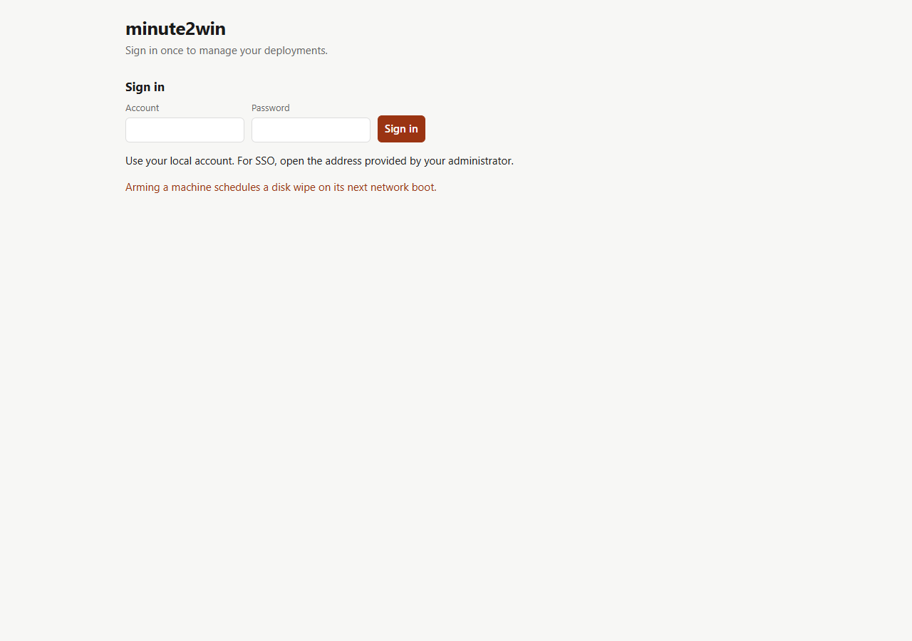

# Sign in once, then manage deployments

Version 0.6.0 replaces the per-device token field with a host login.
Sign in at `/login`, then arm and disarm permitted machines without entering a
credential again. Local accounts, native OIDC SSO and personal MCP/API tokens use
the same role and image-scope policy.

The server's `M2W_TOKEN` remains a bootstrap administrator credential. Sign in as
`server-admin` with that token to get started. Store it in the host's secret
facility; routine MCP clients should receive scoped personal tokens instead.
The no-token loopback preview still works without accounts.



*Synthetic browser-test data. The screenshot uses synthetic accounts; real Authentik interoperability has not yet been verified for this release.*

## Roles and image scopes

| Role | Access |
| --- | --- |
| Viewer | Read permitted profiles, arms, deployment progress and setup guidance |
| Operator | Viewer access plus arming/disarming permitted images |
| Admin | All images, profile/media/configuration changes and account management |

An account's `profiles` array contains exact profile names. `[]` grants no images;
`["*"]` grants every image. The same checks apply to console forms, JSON API and
MCP calls. State and profile listings are filtered to the caller's image scope.
Once accounts, native OIDC or proxy SSO are configured, deployment details require
authentication. `/healthz` is a credential-free, detail-free health check.

## Local accounts and personal tokens

Start with `-auth-file <protected-path>/accounts.json`. With MCP and persistent
`-data`, the default is `<data>/accounts.json`. Its parent must exist and be
writable by the server account. From an administrative MCP connection, call:

```json
{"name":"account_put","arguments":{"username":"lab-operator","role":"operator","profiles":["lab-win11"],"password":"a-unique-long-local-passphrase"}}
```

Passwords must be 12–1024 bytes. They are stored with a random salt and
PBKDF2-HMAC-SHA256 with 600,000 iterations, never plaintext. Do not commit this
operator data file or put account credentials in deployment profiles.

Issue the account an API/MCP credential:

```json
{"name":"account_token_create","arguments":{"username":"lab-operator"}}
```

The secret is returned once; only its SHA-256 is stored. It inherits the account's
current role and profiles. Updating an account's password, role, scope or OIDC
binding revokes its existing sessions and tokens. Deleting an account also
revokes them. Updating without a password preserves the old password. Use a new
password when replacing a compromised local credential.

Local sessions last 12 hours and are held in memory. Cookies are host-only,
HttpOnly. Local sessions use SameSite=Strict; SSO sessions use SameSite=Lax
to complete top-level IdP redirects. HTTPS sessions and OIDC-enabled hosts use
Secure cookies. Signing out revokes that session. Restarting the host drops all browser
sessions, but accounts and personal tokens persist. Sign-in attempts are bounded
per source address. Deploy HTTPS for remote browser/API access; the existing
plain-HTTP LAN transport does not encrypt credentials.

## Native OIDC, including Authentik

Configure these environment variables on the minute2win host:

```text
M2W_OIDC_ISSUER=https://auth.example.net/application/o/minute2win/
M2W_OIDC_CLIENT_ID=minute2win
M2W_OIDC_PUBLIC_URL=https://deploy.example.net
M2W_OIDC_ADMIN_GROUP=minute2win-admins
M2W_OIDC_OPERATOR_GROUP=minute2win-operators
M2W_OIDC_OPERATOR_PROFILES=lab-win11,lab-debian
```

`M2W_TOKEN` is still required for bootstrap administration. Public URL must be an
HTTPS origin; issuer must be HTTPS. Optional `M2W_OIDC_CLIENT_SECRET` enables a
confidential client. A public client with S256 PKCE needs no shared client secret.
The provider must allow **authorization_code**, return signed ID tokens, permit
`openid profile email groups` scopes, and register the exact callback:

```text
https://deploy.example.net/auth/callback
```

The login page offers **Sign in with SSO**. The app verifies a browser-bound
state, one-use flow, S256 PKCE, nonce, issuer, audience, signature and expiry. It
does not auto-link local users by email or a mutable username.

Every authenticated OIDC identity defaults to viewer with all-image read access.
Configured operator-group members get only the images in
`M2W_OIDC_OPERATOR_PROFILES` (empty means none); the configured admin group grants
administrator access. No group name grants privileges unless configured.

For per-user control, bind the immutable OIDC `sub` with `account_put`:

```json
{"name":"account_put","arguments":{"username":"imaging-team-member","oidc_subject":"IMMUTABLE_SUB_FROM_THE_PROVIDER","role":"operator","profiles":["lab-win11"]}}
```

An explicit binding overrides group defaults, including the admin group. A
default SSO identity appears as `oidc:<sub>` in the console. After provisioning
the binding, issue a personal token for its account to connect MCP. OIDC browser
cookies and provider tokens are not accepted as personal MCP bearer tokens.

SSO sessions last at most one hour and never beyond the validated ID token's
expiry. IdP group changes take effect on the next login, within that window;
this implementation does not provide back-channel logout or group polling.
Local mapped-account changes revoke its sessions immediately. Application sign
out clears the local session; it does not sign the browser out of the IdP.

For Authentik, create an OAuth2/OIDC provider with the code grant explicitly
enabled, `sub_mode: hashed_user_id`, the exact callback, a signing key and a
`groups` scope mapping that returns an array of group names. The Homelab GitOps
integration is maintained in `HomeLab_ac`; its prepared component must be paired
with an image containing these new server features before activation. Consult
[Authentik's provider reference](https://docs.goauthentik.io/add-secure-apps/providers/oauth2/)
for its endpoints and grant settings.

OIDC discovery is lazy so an unavailable IdP does not stop deployment service or
local account login. A discovery/code-exchange failure gives a useful sign-in
error. Check DNS, TLS, the exact issuer/client/callback, PKCE and grant settings.
Do not put interactive proxy challenges in front of discovery, JWKS or token
endpoints needed by the application.

## Optional trusted-proxy SSO

For an already authenticated reverse proxy, set
`-auth-proxy-user-header X-authentik-username` and a random
`M2W_PROXY_SECRET` of at least 32 bytes. The proxy must strip client-supplied
identity and `X-M2W-Proxy-Secret` headers, authenticate, then inject its exact
provisioned account name plus that secret. Unknown identities get no access.
Only trust this header on a protected upstream connection. Native OIDC avoids
this shared-secret/header integration and is the homelab rollout's chosen path.

MCP always requires its explicit bearer token and ignores browser cookies and
proxy identity headers. The MCP endpoint is not an OAuth authorization server.

## Keep the installer network usable

Targets still use one-time boot tickets and per-deployment capabilities/report
keys. They cannot complete interactive SSO. Keep `/boot`, `/manifest`, `/linux`
and `/api/report` reachable from the deployment LAN. A public console ingress
should expose only control/auth routes; it need not expose those target routes.
Do not forward the operator token to an installer.

Arm/disarm and account changes emit structured audit entries to the server log,
with actor, role, target/image and outcome. Tokens and passwords are not logged.
Configure your service/container log retention for the audit history you need.
