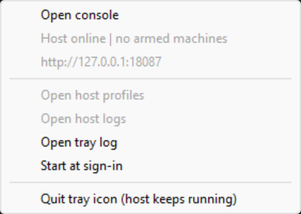

# Desktop status icon

`minute2win-tray` adds a native notification-area icon on Windows, a menu-bar icon on macOS, or a StatusNotifier/AppIndicator icon on Linux. It connects to an existing server. **Open console** takes you to the web console, where you can pick a Windows or Linux profile and arm a machine.

Run the server separately, or keep your existing service/scheduled task. The companion runs as your signed-in user without administrator rights. **Quit tray icon (host keeps running)** closes only the icon; pending arms and deployments continue.



*A native menu capture using synthetic loopback data, not a deployment result.*

## Start it

Check the release's `SHA256SUMS` and extract your platform's server package. Windows includes a signed `minute2win-tray.exe` beside the signed server. Linux includes `minute2win-tray`. macOS Intel and Apple silicon archives include the server and `minute2win Tray.app`.

Windows PowerShell:

```powershell
.\minute2win-tray.exe -url http://127.0.0.1:8080 -host-root C:\ProgramData\minute2win
```

Linux:

```bash
./minute2win-tray -url http://127.0.0.1:8080 -host-root /srv/minute2win
# Or use the AppImage's explicit companion mode:
./minute2win-server-X-x86_64.AppImage --tray -url http://127.0.0.1:8080
```

On macOS, move the extracted folder to a permanent location and open `minute2win Tray.app`. It defaults to loopback. To choose another host:

```bash
open 'minute2win Tray.app' --args -url https://console.example.com
```

The macOS bundle is **ad-hoc signed, not Apple Developer ID signed or notarized**. Gatekeeper may block a downloaded copy. Check the archive hash and use macOS's explicit Open Anyway action only if you trust it. Linux needs a graphical login with a StatusNotifier/AppIndicator provider; GNOME may need its AppIndicator extension. SSH sessions and headless hosts do not provide a tray.

`-url` accepts an HTTP(S) origin with no credentials, path, query or fragment. It defaults to loopback. The companion never reads or sends `M2W_TOKEN`; enter your token in the console when needed. Omit `-host-root` for remote hosts: profile/log directories cannot be opened through the API, and those two menu entries are disabled without a local directory.

## Read the status

| Icon | Meaning |
| --- | --- |
| Green | Host responded, with no machines armed or deploying |
| Amber | Machines armed, waiting to network boot |
| Blue | Server reports booting or running deployments |
| Red | Host degraded; deployment work is refused |
| Gray | Checking or unreachable; current host state unknown |

The menu and tooltip show text and counts too. Status refreshes every three seconds with a two-second timeout. An unreachable host replaces the last state. Counts are server telemetry: a stalled client can remain "running," and a completed report does not independently verify the installed OS. Open the console for phases, history and failures.

## Start at sign-in

Choose **Start at sign-in**. This registers only the companion for your user: Windows `HKCU` Run, a macOS LaunchAgent, or Linux XDG autostart. Keep the folder/AppImage at a permanent path first. AppImage startup uses the original image path instead of its temporary mount. Turn the option off before moving/removing the app; a loaded macOS login agent is released at logout.

For scripted setup, run the executable with the same arguments plus `-install-startup`; use `-remove-startup` to undo it. Both exit without showing an icon. `-check` prints host status and exits without requiring a graphical session. A second icon for the same origin in the same user session exits.

**Open tray log** shows connection changes and errors. Logs are in `%LocalAppData%\minute2win\tray.log`, `~/Library/Caches/minute2win/tray.log`, or `${XDG_CACHE_HOME:-~/.cache}/minute2win/tray.log`.

Native Windows menu interaction is checked on the maintainer's host. macOS/Linux builds and non-GUI status checks run in CI; graphical menu interaction and next-login startup still need live desktop validation. Companion checks do not verify target installation.
