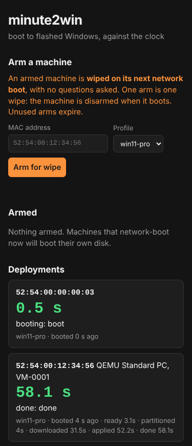

# Getting started

This guide describes the setup on any platform. For a complete worked example on one Windows PC, with every command and what each screen shows, follow the [Walkthrough](WALKTHROUGH.md). The full chain has been verified on one disposable UEFI VM (see [Status](STATUS.md)); validate it on a disposable VM before hardware.

## 1. Gather prerequisites

You need a Windows x64 or Linux server host reachable from the target, a normal DHCP service, an iPXE boot route, and a disposable x64 UEFI test target with an eligible internal disk (default minimum 64 GB). The engine partitions GPT and runs bcdboot for UEFI; BIOS iPXE observations do not establish BIOS Windows installation support.

Supply your own licensed Windows image, WinPE built with the Windows ADK and WinPE add-on, wimboot, BCD and boot.sdi. The HTTP console and the boot-asset host are separate roles; they can run on the same machine but the console does not serve the staged boot tree. The image source currently supports HTTPS only. The target must trust its certificate.

## 2. Preview the console

Extract a [server release](https://github.com/spilloid/minute2win/releases) and verify its checksums. Start it with `-listen 127.0.0.1:8080`. Open the console at <http://localhost:8080>. Windows opens the browser by default; Linux users open it themselves.

The current source listens on `127.0.0.1:8080` by default, and without `-image-base` it refuses every arm, so a preview cannot start a deployment. Release 0.1.2 and earlier listened on every interface by default and did not check where requests came from: with those builds pass `-listen 127.0.0.1:8080` explicitly and set `M2W_TOKEN` even for a preview, or any web page open in your browser could arm a machine.



*Demo data from the automated UI test: the MAC, the QEMU machine and the 58.1 s lap times are fixtures, not a measured deployment.* The page works at phone width and follows the light or dark setting.

Do not arm a real target during a preview. Binding to loopback prevents remote targets reaching the console, but is not a deployment simulation.

## 3. Create your deployment profile

Create a separate directory such as `profiles/` and copy a template from `manifests/examples/` in the source checkout, or adapt the included `manifests/win11-pro.json`. The included profile is a template: its image URL is on the placeholder host `your-image-host.invalid` and its hash is all zeros, and the server refuses to arm it until you replace both. Set an HTTPS image URI, its exact SHA-256, and the image edition. Use a profile filename such as `lab-win11.json`; the UI calls it `lab-win11`.

On Windows, compute the image hash with:

```powershell
Get-FileHash C:\images\install.wim -Algorithm SHA256
```

On Linux:

```bash
sha256sum /srv/images/install.wim
```

Keep `tenant.joinMethod` as `none`, `oobe.adminUser` as `null`, and the default countdown for initial testing. The server refuses to arm a profile whose image URL is a documentation placeholder or whose hash is missing or all zeros. Read [Manifest reference](MANIFESTS.md) for capacity checks and the consequences of creating a local OOBE administrator.

## 4. Build and host the boot assets

Follow [Boot assets](BOOT_ASSETS.md). Build WinPE with `-Base` set to your own boot-asset URL. Stage the matching engine scripts under that same base. Confirm from the deployment network that the boot files, scripts and Windows image are reachable.

## 5. Start a reachable server

Use an actual LAN address or wildcard listener, your own profiles, and your own image base. On any address other machines can reach, the server refuses to start without `M2W_TOKEN`. For example, on Linux:

```bash
export M2W_TOKEN='replace-with-a-long-random-token'
./minute2win-server -listen :8080 -manifests ./profiles -data ./data \
  -image-base https://deploy.example.net/windows11 -open=false
```

Replace `deploy.example.net` with your host (the server refuses the placeholder). Permit TCP 8080 from the deployment network. On Windows, set `$env:M2W_TOKEN` and pass the same flags to `minute2win-server.exe`.

The token is for you, not for the machines being imaged: arming and disarming need it, while the routes a booting machine uses (`/boot/<mac>`, `/manifest/<mac>`, and the engine's `/api/report`, which has its own per-deployment key) do not. Use a trusted deployment network: state and boot routes remain reachable without the token. `-insecure-no-token` lets the server listen on the network without a token; use it only on an isolated lab network where anyone who can reach the port may wipe machines. HTTP does not encrypt the token; use network isolation or an appropriately configured TLS front end.

Choose one boot route:

- **Existing iPXE:** chain the URL printed by the server, such as `chain http://192.168.1.50:8080/boot/${net0/mac}`.
- **Built-in PXE:** add `-pxe -pxe-dir /srv/ipxe` with your own iPXE files and allow UDP 67, 69 and 4011. Linux needs privileged-port access; Windows needs Administrator. Keep normal DHCP running. See [Server reference](SERVER.md).
- **USB/iPXE:** configure your boot drive to chain the server URL. The separate [kvm-it project](https://github.com/spilloid/kvm-it) provides one such boot route.

## 6. Arm once and observe

Confirm the VM's MAC and that its disk is disposable. In the console enter the token, select your profile, and arm that MAC. Boot it through iPXE. iPXE requests `/boot/<mac>` and follows the one-time URL it is given, which consumes the arm; the deployment appears on the board.

If the boot fails after consumption, diagnose it before re-arming. Disarming cannot cancel an already started deployment. In WinPE, any key during the countdown aborts; a zero countdown removes that opportunity.

Check the actual Windows boot and logs rather than treating a board outcome as proof. Logs should be copied to `C:\Windows\Logs\minute2win\`. Validate the whole sequence against [Status](STATUS.md), record the VM configuration and timing, then test another network boot without re-arming: it must not deploy again.
