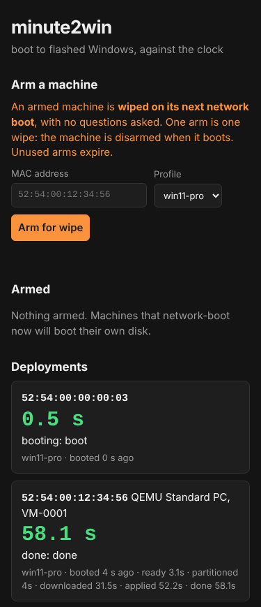

# Getting started

This is the short version, for any platform, for people comfortable with PXE and their own network. If you'd rather have every command and every screen spelled out on one Windows PC, take the [Walkthrough](WALKTHROUGH.md) instead.

The full chain has run end to end on one disposable UEFI virtual machine (see [Status](STATUS.md)). Try it on a disposable VM before any real hardware.

## 1. Gather the pieces

**On the minute2win side** you need:

- A **server**: a Windows x64 or Linux machine the target can reach.
- Your **normal DHCP server**, unchanged. minute2win never hands out addresses.
- A **way to network boot into iPXE**: minute2win's built-in PXE, your existing iPXE setup, or a USB stick.
- A **test target**: an x64 UEFI machine (a VM is ideal) with an internal disk you don't mind losing, 64 GB or more by default. The engine sets up GPT partitions and UEFI boot. BIOS-only installs aren't supported, even though BIOS iPXE has been seen to boot.

**And a few things you bring**, because they're Microsoft's or yours:

- A licensed **Windows image** (`install.wim`).
- **WinPE**, built with the Windows ADK and the WinPE add-on (this repo's builder does the work).
- **wimboot**, plus the **BCD** and **boot.sdi** that come out of the WinPE build.
- **HTTPS hosting for the image.** The image source is HTTPS only, and WinPE has to trust the certificate.

The minute2win console and the boot files are two separate jobs. They can live on the same machine, but the console doesn't serve the boot files. You'll run a simple web server for those.

## 2. Have a look at the console

Download a [server release](https://github.com/spilloid/minute2win/releases), check it against `SHA256SUMS` and unzip it. Start it with `-listen 127.0.0.1:8080` and open <http://localhost:8080>. Windows opens the browser for you; on Linux, open it yourself.

This is a safe preview. Since 0.2.0 the server listens only on your own machine by default, and it won't arm anything until you give it `-image-base`. (On 0.1.2 and earlier, pass `-listen 127.0.0.1:8080` and set `M2W_TOKEN` even for a preview. Those builds listened everywhere and didn't check where requests came from, so any web page open in your browser could arm a machine.)



*Demo data from the automated UI test. The MAC, the QEMU machine and the 58.1 s lap times are fixtures, not a measured deployment.* The console works on a phone, in light or dark mode.

Don't arm a real machine during the preview. Listening only on your own machine keeps other machines from reaching it, but it isn't a simulation.

## 3. Write a deployment profile

A profile tells minute2win which image to install and how. Make a folder such as `profiles/` and copy in `manifests/examples/example.json` from the source, or the included `manifests/win11-pro.json`.

The included profile is a template on purpose. Its image URL points at `your-image-host.invalid` and its hash is all zeros, and the server refuses to arm it until you replace both. Fill in:

- your **HTTPS image URL**,
- the image's exact **SHA-256**,
- the **edition** name inside the image (for example `Windows 11 Pro`).

To get the hash on Windows:

```powershell
Get-FileHash C:\images\install.wim -Algorithm SHA256
```

On Linux:

```bash
sha256sum /srv/images/install.wim
```

The file name becomes the profile's name: `lab-win11.json` shows up in the console as `lab-win11`.

For your first runs, keep the safe defaults: `tenant.joinMethod` as `none`, `oobe.adminUser` as `null`, and the default countdown. The [manifest reference](MANIFESTS.md) covers disk-size checks, and what happens if you have setup create a local administrator.

## 4. Build and host the boot files

Follow [Boot assets](BOOT_ASSETS.md). The key thing is that the addresses all line up:

- Build WinPE with `-Base` set to the URL where you'll host the boot files.
- Put the matching engine scripts under that same URL.
- From the deployment network, check that the boot files, the scripts and the Windows image all download.

## 5. Start the server on your network

Now point the server at your profiles and boot files, and let other machines reach it. On any address other machines can reach, the server won't start without `M2W_TOKEN`. On Linux, for example:

```bash
export M2W_TOKEN='replace-with-a-long-random-token'
./minute2win-server -listen :8080 -manifests ./profiles -data ./data \
  -image-base https://deploy.example.net/windows11 -open=false
```

Swap `deploy.example.net` for your own host (the server refuses the placeholder), and allow TCP 8080 from the deployment network. On Windows, set `$env:M2W_TOKEN` and give `minute2win-server.exe` the same flags.

**What the token is for:** it's for you, not for the machines being imaged. You need it to arm and disarm. The routes a booting machine uses don't need it: `/boot/<mac>`, `/manifest/<mac>`, and the engine's `/api/report`, which has its own per-deployment key.

**Keep it on a trusted network.** The state and boot routes can be reached without the token. The console speaks plain HTTP, so the token isn't encrypted on the wire; isolate the network or put a TLS front end in front of it. `-insecure-no-token` lets the server listen on the network with no token at all. Use it only on an isolated lab network, where anyone who can reach the port may wipe machines.

Then pick **one** way for machines to boot into minute2win:

- **Existing iPXE:** chain the URL the server prints, such as `chain http://192.168.1.50:8080/boot/${net0/mac}`.
- **Built-in PXE:** add `-pxe -pxe-dir /srv/ipxe` with your own iPXE files, and allow UDP 67, 69 and 4011. Linux needs permission for privileged ports; Windows needs Administrator. Keep your normal DHCP server running. Details are in the [server reference](SERVER.md).
- **USB/iPXE:** set up a boot stick that chains the server URL. The separate [kvm-it project](https://github.com/spilloid/kvm-it) is one way to do this.

## 6. Arm it once and watch

Double-check the VM's MAC, and that its disk really is disposable. Sign in once at /login as server-admin with your operator token (or use a configured local/SSO account), then pick your profile and arm that MAC. Then boot the VM.

iPXE asks for `/boot/<mac>`, follows the one-time link it gets back, and that uses up the arm. The deployment shows up on the board.

Good to know while it runs:

- **The countdown is your stop button.** In WinPE, any key during the countdown aborts. A countdown of zero means there's no chance to stop it.
- **Disarming can't stop a deployment that has already started.**
- **If it fails after the arm was used,** work out why before arming again. [Troubleshooting](TROUBLESHOOTING.md) has the common causes.

When it's done, check that Windows really boots and look at the logs, which are copied to `C:\Windows\Logs\minute2win\`. The board shows what the engine reported, and the logs and the working Windows are the proof.

Last check: **network boot the VM again without arming it.** It must boot Windows, not deploy again. Compare what you saw with [Status](STATUS.md), and note your VM setup and timings.
