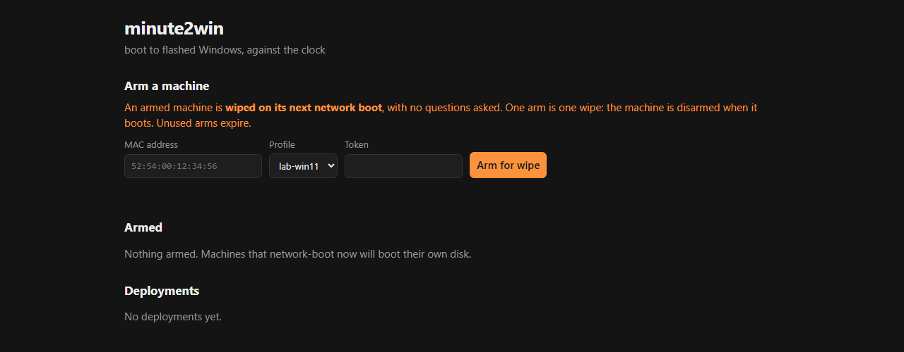
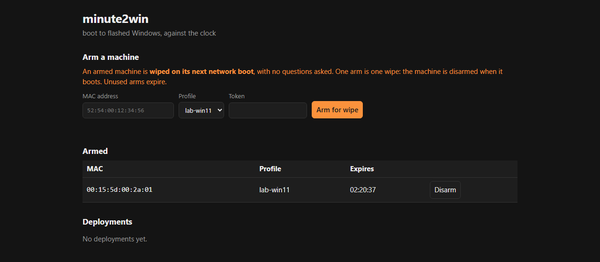
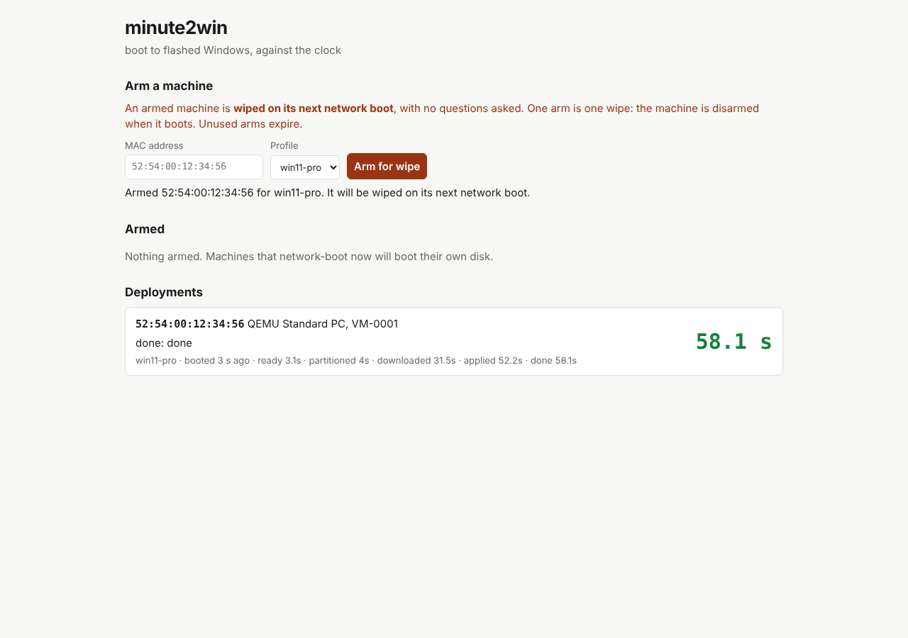

# Your first deployment, start to finish

**One Windows PC. One Hyper-V virtual machine. At the end, you click Arm, reboot the VM, and it reinstalls Windows by itself while you watch the lap times come in.**

This walkthrough puts every piece on one PC so you can see the whole thing work before you point it at real hardware. It is long because it covers everything, from downloads to a working loop. Most of the time goes on downloads (the Windows ADK and a Windows image), not on minute2win.

> **Deployment erases the selected disk without asking.** That is the design: arming a machine is the authorization to reimage it. In this walkthrough the only thing that gets armed is a brand-new, empty VM. Keep it that way until you have watched a full run.

> **What is verified, and what this adds.** The chain this guide builds (Windows-hosted built-in PXE, iPXE, wimboot, WinPE, the engine, first boot) is the one that ran end to end on a disposable UEFI VM; see [Status](STATUS.md). That run's VM was on Proxmox. This guide uses a Hyper-V Generation 2 VM instead, because it is on every Windows Pro PC; that exact combination is not yet in the verification record. If it works for you (or doesn't), [say so in an issue](https://github.com/spilloid/minute2win/issues): it is useful evidence.

## The plan

```text
┌──────────────────────────── your Windows PC ────────────────────────────┐
│                                                                          │
│  minute2win-server.exe     console + API on :8080, built-in PXE          │
│  file server on :8081      WinPE, wimboot, the engine scripts            │
│  Hyper-V VM "m2w-lab"      network boots first; the machine we reimage   │
│                                                                          │
└──────────────────── wired Ethernet to your router ───────────────────────┘
                                   │
                     your router: ordinary DHCP, unchanged
                                   │
          an HTTPS host somewhere: your Windows image (install.wim)
```

The VM shares your PC's wired network through a Hyper-V external switch, so it sits on your LAN like any other machine. Your router keeps handing out addresses. minute2win's built-in PXE answers only the one MAC address you arm.

### What you need

| | |
| --- | --- |
| **PC** | Windows 11 Pro, Enterprise or Education (Home has no Hyper-V), 16 GB RAM or more, about 120 GB free disk, admin rights |
| **Network** | Wired Ethernet. Hyper-V external switches on Wi-Fi are unreliable for network boot |
| **Windows** | A Windows 11 ISO and a license for what you install. minute2win does not include Windows |
| **Image host** | Somewhere that serves your `install.wim` over **HTTPS** with a certificate WinPE trusts. See [step 5](#5-prepare-the-windows-image) |
| **Time** | An afternoon the first time. Re-imaging afterwards is one click and a reboot |

Every command below runs in **Windows PowerShell as Administrator** unless it says otherwise. Replace `192.168.1.50` everywhere with your PC's address (step 2 shows how to find it).

## 1. Make a home for everything

```powershell
New-Item -ItemType Directory -Force C:\m2w\server, C:\m2w\boot, C:\m2w\ipxe, C:\m2w\image, C:\m2w\profiles, C:\m2w\data, C:\m2w\vm | Out-Null
```

By the end it will look like this:

```text
C:\m2w\
  server\minute2win-server\    the release: minute2win-server.exe, manifests\
  src\                         the source (for the WinPE builder)
  boot\windows11\              everything WinPE fetches, served on :8081
  ipxe\ipxe.efi                handed to the VM over TFTP
  image\install.wim            your Windows image (before you upload it)
  profiles\lab-win11.json      your deployment profile
  data\                        server state
  vm\                          the VM's virtual disk
```

## 2. Hyper-V and the network

Turn on Hyper-V (this reboots the PC):

```powershell
Enable-WindowsOptionalFeature -Online -FeatureName Microsoft-Hyper-V -All
```

After the reboot, find your wired adapter's name and give Hyper-V an external switch on it. Your network drops for a few seconds while the switch is created.

```powershell
Get-NetAdapter -Physical | Where-Object Status -eq Up      # note the Name, e.g. "Ethernet"
New-VMSwitch -Name m2w-lan -NetAdapterName 'Ethernet' -AllowManagementOS $true
```

Your PC's LAN address now lives on the switch's virtual adapter. Find it, and make that network Private so the firewall rules in step 7 apply:

```powershell
Get-NetIPAddress -InterfaceAlias 'vEthernet (m2w-lan)' -AddressFamily IPv4 | Select-Object IPAddress
Set-NetConnectionProfile -InterfaceAlias 'vEthernet (m2w-lan)' -NetworkCategory Private
```

That address is **your server address** for the rest of this guide (shown as `192.168.1.50`). WinPE is built with it baked in, so **give it a DHCP reservation in your router** now. If it changes later, you will be rebuilding WinPE.

## 3. Download minute2win and check it

From the [latest release](https://github.com/spilloid/minute2win/releases/latest), download into `C:\m2w`:

- `minute2win-server-<version>-windows-x64.zip`, the server (Authenticode-signed)
- `minute2win-<version>-bootfiles.zip`, the engine scripts WinPE downloads
- `SHA256SUMS`

Then check the hashes and unpack. Each file's hash must match its line in `SHA256SUMS`:

```powershell
cd C:\m2w
Get-FileHash .\minute2win-*.zip -Algorithm SHA256 | Format-Table Hash, Path -AutoSize
Get-Content .\SHA256SUMS

Expand-Archive .\minute2win-server-*-windows-x64.zip -DestinationPath C:\m2w\server -Force
Expand-Archive .\minute2win-*-bootfiles.zip -DestinationPath C:\m2w\boot -Force
```

You need the source too, for the WinPE builder. Download **Source code (zip)** from the same release page and unpack it so that `C:\m2w\src\build\Build-WinPE.ps1` exists (the zip has one top folder; move its contents up into `C:\m2w\src`).

Check: `C:\m2w\boot\windows11\install.ps1` and `C:\m2w\boot\windows11\minute2win\Minute2Win.psm1` should both exist.

## 4. Build WinPE

Install two things from [Microsoft's ADK page](https://learn.microsoft.com/windows-hardware/get-started/adk-install), in this order:

1. **Windows ADK** (the *Deployment Tools* feature is the one you need)
2. **Windows PE add-on** for the same ADK version

The documented build baseline is ADK 10.1.26100.x. Then open **Start → Deployment and Imaging Tools Environment**, right-click, **Run as administrator**, and run:

```bat
powershell -NoProfile -ExecutionPolicy Bypass -File C:\m2w\src\build\Build-WinPE.ps1 -Work C:\WinPE_m2w -Base http://192.168.1.50:8081/windows11
```

`-Base` is where WinPE will look for its engine: the file server you start in step 7. Use your server address. The builder **deletes `C:\WinPE_m2w` first**, so don't point `-Work` at anything you care about. It takes several minutes and ends with `Done: C:\WinPE_m2w\out`.

Copy its output next to the engine scripts, and add wimboot from the iPXE project:

```powershell
Copy-Item C:\WinPE_m2w\out\boot.wim, C:\WinPE_m2w\out\BCD, C:\WinPE_m2w\out\boot.sdi C:\m2w\boot\windows11\
Invoke-WebRequest https://github.com/ipxe/wimboot/releases/latest/download/wimboot -OutFile C:\m2w\boot\windows11\wimboot
```

Check: `C:\m2w\boot\windows11\` now holds `wimboot`, `BCD`, `boot.sdi`, `boot.wim`, `install.ps1` and the `minute2win\` folder.

## 5. Prepare the Windows image

### Export a single edition

A Windows ISO holds many editions in one big file. Deploying is faster with just the one you want, so export it. Mount the ISO and look inside:

```powershell
$iso = 'C:\m2w\Win11.iso'      # your downloaded ISO
Mount-DiskImage -ImagePath $iso
$d = (Get-DiskImage -ImagePath $iso | Get-Volume).DriveLetter
$src = if (Test-Path "${d}:\sources\install.wim") { "${d}:\sources\install.wim" } else { "${d}:\sources\install.esd" }
Get-WindowsImage -ImagePath $src | Format-Table ImageIndex, ImageName
```

Export the edition you want by its exact name, then hash the result:

```powershell
Export-WindowsImage -SourceImagePath $src -SourceName 'Windows 11 Pro' -DestinationImagePath C:\m2w\image\install.wim -CompressionType max
Dismount-DiskImage -ImagePath $iso
Get-FileHash C:\m2w\image\install.wim -Algorithm SHA256
```

Keep the hash. It goes into your profile, and the engine refuses to apply any image whose hash doesn't match it.

### Host it over HTTPS

The engine downloads the image over **HTTPS only**, and WinPE must trust the server's certificate. That is the one part of this setup that can't stay on your PC without extra work, because WinPE ships with few trusted root certificates and you can't easily add your own to it.

The route that has worked: **an object-storage bucket with its provider's public certificate** (the verified run used one). Cloudflare R2, Amazon S3, Azure Blob Storage and Backblaze B2 all fit. Two ways to keep your licensed image private:

- **A pre-signed (time-limited) URL.** The engine reads the image with ranged GETs, which pre-signed URLs allow. Make the expiry longer than you plan to test, and update the profile when it expires.
- **An allow-list** on the bucket's custom domain for your public IP address.

Upload `C:\m2w\image\install.wim`, then test the URL from your PC. You want `206` and a byte count of `1`:

```powershell
curl.exe -s -r 0-0 -o NUL -w "%{http_code} %{size_download}`n" "https://<your image URL>"
```

A web server on your own LAN works only if its certificate chains to a root WinPE already trusts. That is not verified anywhere yet; if you try it, a failure shows up as an image-reachability error before the disk is touched.

## 6. Write your profile

A profile is a small JSON file. Fill in your image URL and the hash from step 5. Save it **without a byte-order mark**; this snippet does that (Windows PowerShell's `Set-Content -Encoding UTF8` would add one, and the server would refuse the profile).

```powershell
$json = @'
{
  "schemaVersion": 1,
  "deployment": { "name": "Lab Windows 11 Pro" },
  "image": {
    "source": "https",
    "uri": "https://YOUR-IMAGE-URL/install.wim",
    "sha256": "PASTE-THE-64-HEX-DIGIT-HASH-HERE",
    "edition": "Windows 11 Pro"
  },
  "disk": { "minSizeGB": 64, "stagingGB": 12 },
  "oobe": { "adminUser": null },
  "tenant": { "id": "none", "joinMethod": "none" },
  "guard": { "countdownSeconds": 10 }
}
'@
[IO.File]::WriteAllText('C:\m2w\profiles\lab-win11.json', $json, (New-Object Text.UTF8Encoding($false)))
```

- `edition` must match the `ImageName` you exported, exactly.
- `adminUser: null` means Windows stops at the normal setup screens (OOBE) after install. That is the verified default. Setting a name skips OOBE and creates a local admin with the public password `Password1!`; read the [manifest reference](MANIFESTS.md) before using it.
- `countdownSeconds: 10` gives you ten seconds at the VM's screen to press a key and abort. Keep it for now.

The file name is the profile name: `lab-win11.json` shows up in the console as `lab-win11`.

## 7. Start everything

### iPXE

The VM's firmware first downloads iPXE over TFTP, and iPXE then talks HTTP to minute2win. Get the prebuilt x86-64 UEFI `ipxe.efi` from the [iPXE project](https://ipxe.org/download) and put it at `C:\m2w\ipxe\ipxe.efi`. Keep only iPXE files in that folder: anyone on your network can read it over TFTP.

### Firewall

```powershell
New-NetFirewallRule -DisplayName 'minute2win HTTP' -Direction Inbound -Protocol TCP -LocalPort 8080,8081 -Action Allow -Profile Private
New-NetFirewallRule -DisplayName 'minute2win PXE'  -Direction Inbound -Protocol UDP -LocalPort 67,69,4011 -Action Allow -Profile Private
```

### The file server (terminal 1)

Any static file server works. Two easy ones:

```powershell
# Python
python -m http.server 8081 --directory C:\m2w\boot
# or Caddy (a single exe from caddyserver.com)
caddy file-server --root C:\m2w\boot --listen :8081
```

Leave it running, then check from a second window. Both should print `200`:

```powershell
curl.exe -s -o NUL -w "%{http_code}`n" http://192.168.1.50:8081/windows11/install.ps1
curl.exe -s -o NUL -w "%{http_code}`n" http://192.168.1.50:8081/windows11/boot.wim
```

### minute2win (terminal 2, as Administrator)

Pick a long random token. You type it into the console to arm machines; the machines being imaged never need it.

```powershell
cd C:\m2w\server\minute2win-server
$env:M2W_TOKEN = -join ((48..57) + (97..122) | Get-Random -Count 32 | ForEach-Object { [char]$_ })
"Your token: $env:M2W_TOKEN"     # copy it somewhere safe

.\minute2win-server.exe -listen :8080 -manifests C:\m2w\profiles -data C:\m2w\data `
  -image-base http://192.168.1.50:8081/windows11 `
  -pxe -pxe-dir C:\m2w\ipxe -pxe-ip 192.168.1.50
```

What each flag does: `-listen :8080` lets the VM reach the server (that is also why the token is required); `-image-base` is your file server from above; `-pxe` turns on the built-in proxyDHCP and TFTP; `-pxe-ip` tells it which address to advertise, which Windows needs because Hyper-V gives your PC several network adapters. Administrator is needed for the PXE ports.

**What you'll see** (from the server source; your paths and addresses differ):

```text
minute2win-server on [::]:8080, manifests C:\m2w\profiles, images http://192.168.1.50:8081/windows11
pxe: proxyDHCP on UDP 67 and 4011, TFTP on UDP 69 (read-only, C:\m2w\ipxe); advertising 192.168.1.50 (-pxe-ip, or the address HTTP is bound to); HTTP boot port 8080
pxe: interfaces: ...
pxe: only ARMED MACs get an offer; everything else is ignored and boots its own disk
targets chain: http://192.168.1.50:8080/boot/${net0/mac}
```

There may be one `targets chain` line per network adapter; the one with your server address is the one that matters.

The console opens in your browser. Your profile is in the drop-down, and the token field is there because a token is set:



*Captured from the 0.1.2 Windows release running on loopback with a demo profile.*

## 8. Make the VM

A Generation 2 VM is UEFI, which the engine requires. These commands give it an 80 GB disk (the profile needs at least 64), a fixed MAC address so you can arm it before it ever boots, Secure Boot off (the signed chain is not verified yet), and network first in the boot order.

```powershell
New-VM -Name m2w-lab -Generation 2 -MemoryStartupBytes 4GB -SwitchName m2w-lan `
  -NewVHDPath C:\m2w\vm\m2w-lab.vhdx -NewVHDSizeBytes 80GB
Set-VMMemory -VMName m2w-lab -DynamicMemoryEnabled $false
Set-VMProcessor -VMName m2w-lab -Count 4
Set-VMNetworkAdapter -VMName m2w-lab -StaticMacAddress 00155D002A01
Set-VMFirmware -VMName m2w-lab -EnableSecureBoot Off
Set-VMFirmware -VMName m2w-lab -BootOrder (Get-VMNetworkAdapter -VMName m2w-lab), (Get-VMHardDiskDrive -VMName m2w-lab)
Set-VM -Name m2w-lab -AutomaticCheckpointsEnabled $false
```

Its MAC address is now `00:15:5d:00:2a:01`. Each VM needs its own MAC: change the last digits for a second one.

## 9. Arm it, boot it, watch it

In the console, enter `00:15:5d:00:2a:01`, choose `lab-win11`, paste your token, and press **Arm for wipe**. The VM shows up under **Armed**, with the time its arm expires:



*Captured from the 0.1.2 Windows release on loopback; the MAC is the walkthrough's example.*

If you see an error instead, the console tells you why; the [troubleshooting table](TROUBLESHOOTING.md) lists each one. Now start the VM and open its screen:

```powershell
Start-VM m2w-lab; vmconnect.exe localhost m2w-lab
```

**What you'll see**, in order:

1. **Firmware network boot.** Hyper-V's UEFI says it is starting PXE over IPv4, gets an address from your router and the boot file from minute2win, and downloads `ipxe.efi`. The server logs the offer for your MAC.
2. **iPXE.** It asks minute2win for its boot script, and the arm is used up right then. The screen shows lines from the server:
   ```text
   minute2win: 00:15:5d:00:2a:01 is armed, fetching its one-time deployment script
   minute2win: 00:15:5d:00:2a:01 armed for lab-win11, deploying (this wipes the disk)
   ```
   (Release 0.1.2 and earlier print only the second line.) The **Armed** list in the console empties.
3. **wimboot and WinPE.** Files download, then WinPE starts: `minute2win: waiting for network...` (up to a minute if your network blocks ping to the internet), then the engine:
   ```text
   minute2win <version>
   Deployment: Lab Windows 11 Pro
   Hardware: Microsoft Corporation Virtual Machine, serial ...
   WIPING Disk 0 (Msft Virtual Disk, 80 GB, SCSI) and installing Windows.
   Image reachable: 5.2 GB
   WIPING Disk 0 (...) and installing Windows. Starting in 10s, press any key to abort.
   ```
   **This is your last chance.** Any key in the VM window stops it with nothing changed.
4. **The deployment.** `Partitioning...`, `Downloading and verifying the image...`, `Applying image index 1...`, `Installing first-boot bootstrap...`, `Reclaiming the staging partition...`, `Deployment complete.` Meanwhile a card appears on the board and the lap times fill in:



*Demo data from the automated UI test: the MAC, the QEMU machine and the 58.1 s lap times are fixtures, not a measured deployment. Your card shows your VM and your own times.*

5. **Reboot into Windows.** The VM restarts and network boots again, as its boot order says. This time minute2win stays silent, because the arm is gone, so the firmware moves on to the disk. Windows Setup finishes its own work (this can take several minutes on a VM with a spinner), and you land on the normal **country or region** screen.

**That's a deployed machine.** The engine's step lines appear on the screen as written above; the exact lines in your version may differ a little.

## 10. Check the result

Finish OOBE (or don't; the logs are there either way) and look in `C:\Windows\Logs\minute2win\` inside the VM:

| File | What it tells you |
| --- | --- |
| `timing.json` | Seconds since the engine started at each phase. **Your real numbers.** |
| the deploy transcript | Everything the engine printed |
| `hardware.json` | What the engine saw: model, serial, NICs, disks |
| `setupcomplete.log`, `firstboot.log`, `firstboot-result.json` | The first-boot script ran, and how it went (`status: ok`) |

Then do the most important check: **restart the VM without arming it.** It must boot Windows, not reimage. That is the "one arm, one deployment" rule, working.

## 11. Do it again

This is the fun part. Whenever you want the VM brand new:

1. Arm `00:15:5d:00:2a:01` in the console (from your phone, if you like).
2. Restart the VM.

That's it. Everything else from step 9 happens by itself.

## FAQ

**Nothing happens when the VM boots. It just shows a network boot error, then "No operating system was loaded".**
The VM was not armed, the arm expired (two hours by default), or the server was restarted (arms never survive a restart). Check the console's **Armed** list. If it is armed and still nothing, check that the server is running as Administrator, the firewall rules exist, the network is Private, and `-pxe-ip` is your switch adapter's address.

**The server says it is refusing to start, or that it can't bind a port.**
`-listen :8080` without `M2W_TOKEN` is refused on purpose. "Can't bind UDP 67" means you are not Administrator, or another DHCP or PXE service runs on this PC (Internet Connection Sharing, for example).

**iPXE loads, then fails to fetch wimboot or boot.wim.**
The file server isn't reachable at `-image-base`. Re-run the `curl.exe` checks in step 7 *using the LAN address*, not `localhost`.

**WinPE stops at a command prompt.**
WinPE could not fetch `install.ps1` from the `-Base` you built it with. Usually the address changed or the file server isn't running. Reserve the address and rebuild if needed.

**"Boot manifest was not injected."**
The boot script didn't hand WinPE its profile. Use the server route from this guide (the arm), not a static iPXE script.

**"Image reachable" never appears and the engine fails before the countdown.**
WinPE could not reach your image URL: wrong URL, expired pre-signed link, an IP allow-list that doesn't include you, or a certificate WinPE doesn't trust. The disk has not been touched; fix the URL and re-arm.

**The hash check failed after partitioning.**
The downloaded bytes don't match your profile's `sha256`. The disk is already partitioned at this point, which is why you test on a VM. Recompute the hash of the exact file you uploaded. (One verified run saw a single bad transfer that a retry fixed; the cause is unknown, and the check is why it was caught.)

**Can I use the Hyper-V "Default Switch" instead of an external switch?**
Not recommended. It is a NAT network whose addresses change at every reboot, and the built-in PXE has never been tried on it. Use an external switch on wired Ethernet.

**Does my router need any changes?**
No. minute2win's PXE is proxyDHCP: it never hands out addresses, only adds "boot this file" for the one armed MAC.

**Is it really going to take a minute?**
On this setup, almost certainly not: a VM, a multi-gigabyte image from the internet, and a virtual disk. The one recorded VM run took about six minutes, nearly all of it download and apply. The minute is the target for NVMe and a fast local network; `timing.json` tells you exactly where your seconds went.

**How do I deploy a real PC?**
The same way: arm its MAC (on the BIOS/UEFI setup screen, a sticker, or `getmac` in Windows), enable network boot in its firmware, turn Secure Boot off for now, and make sure WinPE has its network and storage drivers (`Build-WinPE.ps1 -Drivers C:\drivers`). Physical machines are not in the verification record yet, so try one whose disk you truly don't need, and [report what happens](https://github.com/spilloid/minute2win/issues).

## Advice from the runs so far

- **Reserve your server address.** WinPE, the server's flags and the file server all depend on it.
- **Test every new profile on the VM first.** The hash is checked after partitioning, so a bad profile on a real machine leaves an erased disk.
- **Use a single-edition image.** Smaller downloads, faster deployments. It is the biggest speed knob you control.
- **Put the image close.** The download was 43% of the recorded run. A fast local mirror and a fast network are where the minute lives.
- **Save profiles without a BOM.** One verified run was refused because Windows PowerShell 5.1 added one.
- **Treat the board as telemetry, not proof.** It shows what the engine reported. The proof is Windows booting and the logs in `C:\Windows\Logs\minute2win\`.
- **Keep the console on a trusted network.** It speaks plain HTTP: anyone who can read your traffic could read the token. For anything beyond a lab, put it behind a TLS reverse proxy.
- **Arms are cheap; check the MAC anyway.** Arming the wrong MAC wipes the wrong machine. Nothing can know your intent.

## Tidy up

To remove the lab later:

```powershell
Stop-VM m2w-lab -TurnOff; Remove-VM m2w-lab -Force; Remove-Item C:\m2w\vm\m2w-lab.vhdx
Remove-NetFirewallRule -DisplayName 'minute2win HTTP', 'minute2win PXE'
Remove-VMSwitch m2w-lan -Force
```

## Where next

- [Server reference](SERVER.md): every flag, the PXE details, running behind dnsmasq instead.
- [Manifest reference](MANIFESTS.md): disk sizes, OOBE accounts, the countdown.
- [API](API.md): arm machines from scripts.
- [Status](STATUS.md): exactly what has been verified, and how.
