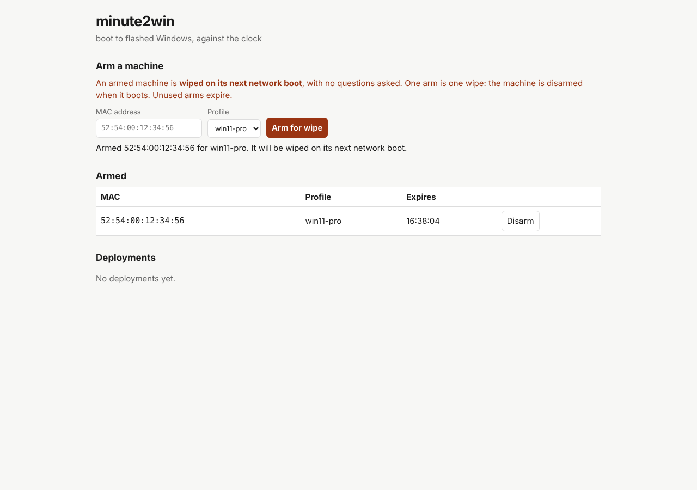
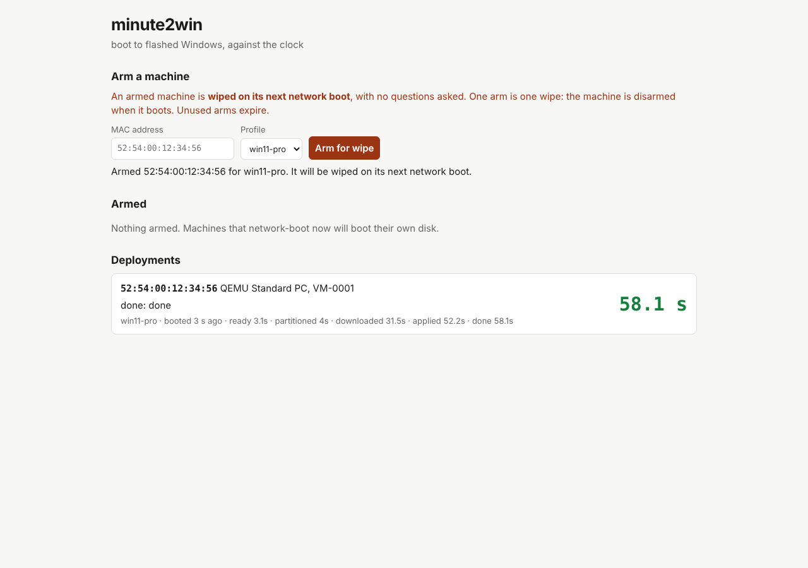

# Reimage workstations from one Windows PC

Set up one Windows PC to give a row of workstations a fresh copy of Windows. **minute2win** decides which machine gets the image and shows the install progress. Its sibling **kvm-it** lets you see the workstation's screen and use its startup menu from your bench.

**Six steps.** Do the first four once. Repeat the last two for each workstation.

- **Read the guide in about 5 minutes.**
- **Set aside an afternoon for your first setup**, including downloads and a test on a spare PC or virtual machine. [Full walkthrough](WALKTHROUGH.md)
- **One Windows 11 test VM took about 6 minutes to install the image.** Windows setup after reboot can add time. Your disk speed and network determine how long each machine takes. [Measured run](validation/2026-10-11-windows-server.md)

## Set up your bench once

### 1. Put both tools on your Windows PC

Unzip the signed Windows x64 build of minute2win and install kvm-it 0.8.2 or newer. Plug the kvm-it adapter's **USB** port into the workstation you want to control. Add an HDMI capture device if you want to see that workstation's screen in kvm-it. [minute2win downloads](https://github.com/spilloid/minute2win/releases) · [kvm-it downloads](https://github.com/spilloid/kvm-it/releases/latest)

### 2. Put your Windows files online

Build **WinPE**, the small Windows environment that starts the install, using Microsoft's Windows ADK and WinPE add-on. Add the network and storage drivers your workstations need. Put WinPE, the minute2win boot files, and your licensed Windows image (`install.wim`) on an HTTPS host. A Cloudflare R2 bucket with a custom domain works for this. [Build and host the boot files](BOOT_ASSETS.md)

### 3. Start minute2win and save your install settings

Copy a Windows profile into `profiles`. Set the image URL, its SHA-256 checksum (the file's fingerprint), and the edition, such as Windows 11 Pro.

On your bench PC, replace the token and image URL below, then run the command in PowerShell. Open `http://localhost:8080` and sign in as `server-admin` with that token. Your workstations need to reach the bench PC on your trusted wired network. [Setup and sign-in](GETTING_STARTED.md) · [Profile settings](MANIFESTS.md)

```powershell
$env:M2W_TOKEN = 'replace-with-your-operator-token'
.\minute2win-server.exe -listen :8080 -manifests .\profiles -data .\data `
  -image-base https://images.example.net/windows11
```

### 4. Choose how the workstations will start

- **Network Boot (PXE).** If the startup menu offers IPv4 network boot, point your existing PXE service at minute2win. If you need a PXE service, add `-pxe -pxe-dir .\ipxe` to the command in step 3 and run it as Administrator with your iPXE boot files in that folder. [Network boot setup](SERVER.md)
- **USB boot with kvm-it.** Use this path if the workstation offers UEFI USB boot and iPXE can see its wired adapter. Your network gives the workstation an IP address through ordinary DHCP. [kvm-it boot-drive setup](https://github.com/spilloid/kvm-it/blob/v0.8.2/docs/getting-started.md#point-the-boot-drive-at-your-deployment-server)

To set up the USB path, connect the adapter's **COM** port to the bench PC and disconnect the adapter in the app. Open **Tools → Devices → Flash adapter → Set boot URL**. Enter `http://192.168.1.50:8080/boot` with your bench PC's LAN address, then select **Append the Ethernet MAC to the URL**. Choose the adapter's COM port and select **Write boot drive**. Reconnect in kvm-it and turn on **Boot drive**.

The drive waits five seconds for a keypress, then sends the workstation's wired MAC to minute2win so it can find the right job. For a bench managed through MCP, use the same URL with `boot_drive_configure` and `append_mac` set to `true`. [Configure the boot drive through MCP](https://github.com/spilloid/kvm-it/blob/v0.8.2/docs/mcp.md#configure-the-usb-boot-drive)

If USB boot cannot see a dock that works with Network Boot, use Network Boot with that dock. Use Windows installer media for a workstation without a working network path. [Boot options](GETTING_STARTED.md)


*A demo startup menu in kvm-it. Each workstation maker labels the options differently.*

## Reimage each workstation

### 5. Check the wired address and arm the machine

Start with a spare PC or virtual machine. Check the MAC address, the ID of the wired adapter you will boot through. On a workstation running Windows, look for **Physical Address** under its wired adapter in `ipconfig /all`. If the startup menu shows a different address for network boot, use that one.

In minute2win, enter the address, pick the Windows profile, and click **Arm for wipe**. **The next minute2win boot will erase the selected internal disk.**



*The Armed list shows which machine is next. This screenshot uses demo data.*

### 6. Boot it and check for Windows

Use kvm-it or the workstation keyboard to select **Network Boot** or the **kvm-it USB drive**. For USB boot, press a key when prompted. The machine claims its one-time arm, and the board shows the install moving along while you get the next workstation ready.



*The board shows when the install finished. The clock in this demo screenshot uses sample data.*

On your first run, check that the new Windows installation starts. Boot the same way again with no new arm. The machine should carry on to Windows. Now the bench is ready to repeat the last two steps.
