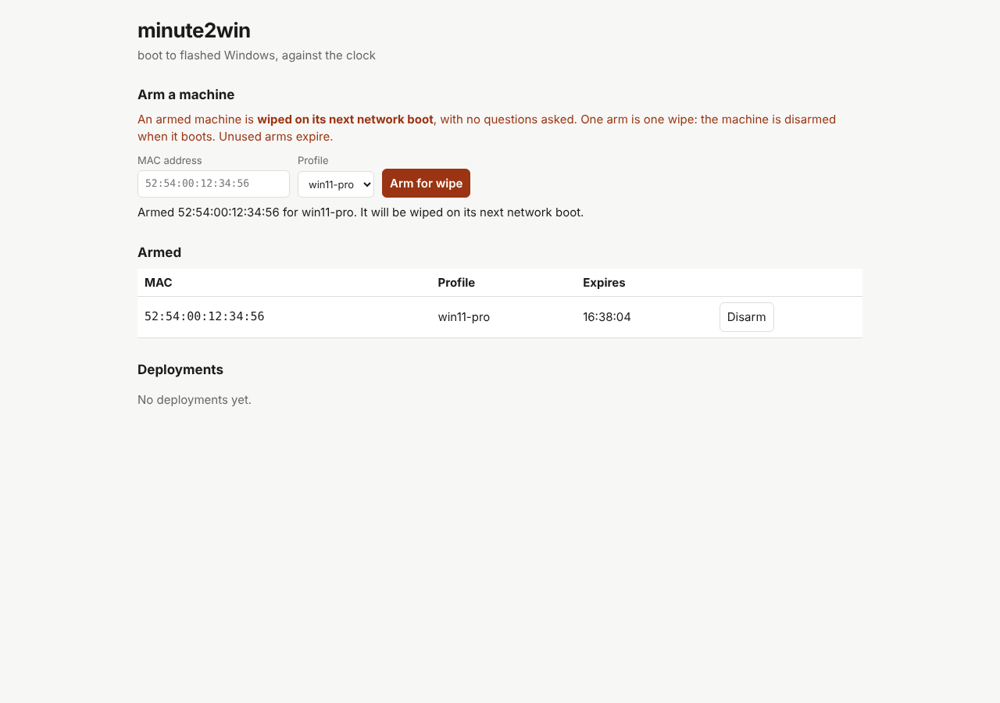

# Minute2Win documentation

A self-hosted console and boot toolkit for zero-touch Windows installation.

**Start here:** [Walkthrough](WALKTHROUGH.md) builds a complete lab on one Windows PC, from downloads to a Hyper-V VM that reimages itself when you arm it, with every command, expected output and an FAQ. [Getting started](GETTING_STARTED.md) is the shorter, platform-neutral version and takes you from an extracted server release to an operator-owned deployment configuration. [Status](STATUS.md) explains what has been verified and what still needs hardware or setup validation.

> Deployment erases the selected disk. Use a disposable VM for initial validation. The one-minute deployment goal has not been measured.

## The console

*Demo data from the automated UI test: the MAC, the QEMU machine and the 58.1 s lap times are fixtures, not a measured deployment.*

| Guide | What it covers |
| --- | --- |
| [Walkthrough](WALKTHROUGH.md) | One Windows PC, end to end: Hyper-V target, built-in PXE, image prep, FAQ and advice |
| [Getting started](GETTING_STARTED.md) | Console preview, prerequisites, profiles, arming and first deployment |
| [Boot assets](BOOT_ASSETS.md) | WinPE build, hosting layout, updating scripts and static iPXE |
| [Manifests](MANIFESTS.md) | Image, disk, OOBE, tenant, guard and reporting settings |
| [Server](SERVER.md) | HTTP console, PXE flags, architecture selection and TFTP behavior |
| [API](API.md) | Read state, arm and disarm machines |
| [Troubleshooting](TROUBLESHOOTING.md) | Boot, network, image, persistence and bootstrap failures |
| [Status](STATUS.md) | Verification evidence, accepted risks and next validation work |
| [Releasing](RELEASING.md) | Signed artifacts, verification and public repository setup |

[Source and downloads](https://github.com/spilloid/minute2win) · [Contributing](https://github.com/spilloid/minute2win/blob/main/CONTRIBUTING.md) · [Security](https://github.com/spilloid/minute2win/blob/main/SECURITY.md)

GitHub Pages hosts this documentation and the [product overview](https://spilloid.github.io/minute2win/) only. It does not host deployment images or run the Minute2Win server.
