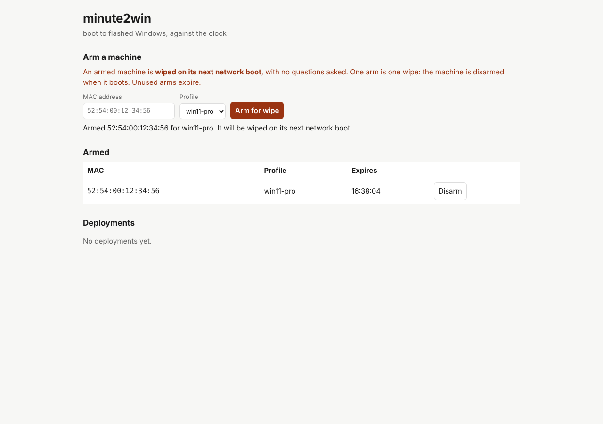
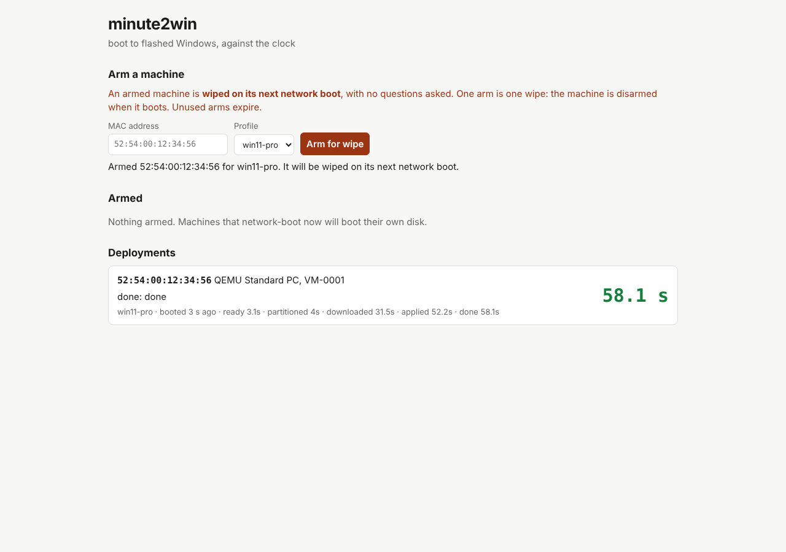

# Minute2Win documentation

Welcome! minute2win reinstalls Windows on a machine over the network. You arm the machine's MAC address in a web console, the machine network boots, and it installs Windows by itself while you watch.

## Where to start

- **New here?** Take the [Walkthrough](WALKTHROUGH.md). It sets up everything on one Windows PC and ends with a Hyper-V virtual machine that reimages itself when you arm it. Every command and every screen you'll see is in there, plus an FAQ.
- **Already know PXE and your network?** [Getting started](GETTING_STARTED.md) is the shorter version, for Windows or Linux.
- **Installing Linux on the target?** [Linux installation](LINUX.md) covers the experimental Debian, Ubuntu Server and Proxmox profiles, which do not need WinPE.
- **Keeping the host in the background?** The [desktop status icon](DESKTOP.md) shows armed/deploying counts and opens the console on Windows, macOS and Linux.
- **Wondering how ready it is?** [Status](STATUS.md) says exactly what's been verified and what hasn't.

> **Arming a machine means "wipe it".** An armed machine's disk is erased on its next network boot, without another prompt. Start with a throwaway virtual machine. And "a minute" is the goal, not a measured result yet.

## The console

Arm a machine, and it shows up in the **Armed** list until it boots:

When it boots, the arm is used up and the board fills in each phase's lap time:

*Demo data from the automated UI test. The MAC, the QEMU machine and the 58.1 s lap times are fixtures, not a measured deployment.*

## All the guides

| Guide | Read it when you want to... |
| --- | --- |
| [Walkthrough](WALKTHROUGH.md) | Do a first deployment on one Windows PC, start to finish |
| [Getting started](GETTING_STARTED.md) | Set up on your own network, on Windows or Linux |
| [Boot assets](BOOT_ASSETS.md) | Build WinPE, lay out the boot files, update the engine scripts |
| [Linux installation](LINUX.md) | Prepare experimental Debian, Ubuntu Server or Proxmox installations |
| [Manifests](MANIFESTS.md) | Configure the image, disk sizes, setup screens, countdown and reporting |
| [Server](SERVER.md) | Look up every server flag, the built-in PXE and TFTP |
| [API](API.md) | Arm, disarm and read state from a script |
| [Troubleshooting](TROUBLESHOOTING.md) | Work out why something didn't happen |
| [Status](STATUS.md) | See the verification record, known issues and what's next |
| [Releasing](RELEASING.md) | Check signed downloads, or cut a release |

[Source and downloads](https://github.com/spilloid/minute2win) · [Contributing](https://github.com/spilloid/minute2win/blob/main/CONTRIBUTING.md) · [Security](https://github.com/spilloid/minute2win/blob/main/SECURITY.md)

This site only hosts the documentation and the [product overview](https://spilloid.github.io/minute2win/). It doesn't host Windows images or boot files, and it doesn't run a minute2win server.
