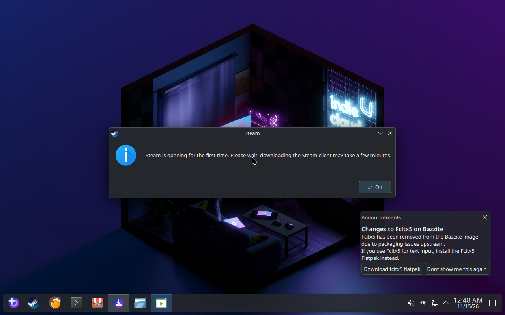
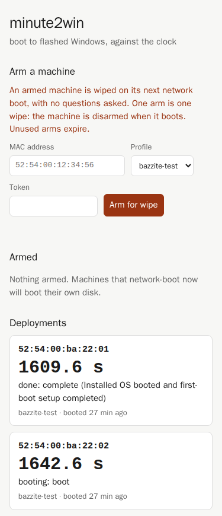

# Bazzite network installer validation, 2026-11-14

Status: final-candidate native unattended install, installed-system first boot, automatic KDE login, SSH administration and an unarmed reboot **passed**. No physical machine was armed.

## Assets

Fedora Everything netinstall x86_64 45-1.4 from official Fedora mirrors. Verified the ISO against its signed CHECKSUM file using Fedora's official signing-key bundle. Fedora 45 signing-key fingerprint: 4F50A6114CD5C6976A7F1179655A4B02F577861E.

| Asset | SHA-256 |
| --- | --- |
| Fedora ISO | 42abc36792f91575b2f541db19110cc661864819031e57cd5f5c9ec764ebbddf |
| images/pxeboot/vmlinuz | 3de692df9e8d14d8dc3c0d935ec4c04fbe9231d8bdc18aeda1b6f0e20c7a1d1c |
| images/pxeboot/initrd.img | 10ab651769a6e93ab574306c19af38922d8b0f398f1c49e11b7d2466668215f4 |
| images/install.img | a72a94cf11bdc03a60db1cc614cb2fb8890d8af36e7ea39e91dd5ef3234ff161 |

Official Bazzite AMD/Intel KDE version 45.20261112, linux/amd64 manifest ghcr.io/ublue-os/bazzite@sha256:1ca1d7b5b93b9b00d07c602b6e0ace73933216a9c6eacc233e2bcb254aab2d25. Its 256 compressed layers total 4,448,160,218 bytes. Initial installation uses the immutable digest without container-signature enforcement; the installed system configures signed stable updates. A digest pin does not establish container-signature verification.

## Checks passed

- Native Windows Go vet and full server tests; final Bazzite regressions.
- Native Linux full server tests and race tests, including disk-selection fixtures. Generated Bazzite scripts pass native shell syntax checks.
- Fedora 45 ksvalidator accepted the configuration fetched through an actual arm and one-time boot ticket.
- Existing Playwright console flow, phone/desktop overflow checks and light/dark captures.
- Product-page version check and diff whitespace check.

Pester/PSScriptAnalyzer, Windows runtime, Linux race/cross-build, browser, workflow, AppImage and documentation CI jobs passed for the initial implementation. The desktop fix also passed the complete [CI run](https://github.com/spilloid/minute2win/actions/runs/43657639463) and documentation workflow. The local legacy PowerShell container could not resolve Pester from the gallery; CI's native PowerShell check passed. Independent review remains pending.

## Native VM

Reused kvm-it/tools/ipxe-test/boot-vm.sh by path and its signed iPXE FAT boot image. QEMU/KVM, OVMF UEFI with Secure Boot disabled, two vCPUs, 8 GiB RAM, virtio network and a blank 80 GiB NVMe virtual disk. Boot USB is read-only. No physical disk or operator private SSH key is exposed. Test server, state and SSH key are disposable.

The first attempt exposed Anaconda's requirement for tree metadata. Corrected inst.stage2 to name the capability-gated tree and added .treeinfo pointing to the pinned runtime, then retried with a fresh blank disk. The second attempt downloaded its runtime, passed the guard/countdown, selected internal NVMe, created EFI/ext4/Btrfs partitions and began importing Bazzite. It did not select the boot USB. Console/SSH diagnostics were enabled in the live installer to inspect logs; no installer selections or installed-system configuration were entered manually.

The initial native install reported complete at 23:59:10 UTC, 1,727.9 seconds after its one-time boot ticket was consumed. SSH authenticated as the configured key-only wheel user, passwordless sudo worked, SELinux was enforcing and bootc reported the exact pinned digest with signed stable update policy. Anaconda had selected a console boot target, and this image uses Plasma Login Manager rather than SDDM. Corrected the Kickstart graphical-target setting and detected the installed display manager in the post-install hook. Applying those corrections to the installed test guest opened an actual Wayland Plasma session and Bazzite Portal. The final fresh blank-disk run verified the corrected complete unattended path, as recorded below.

An initial final-candidate retry failed during the registry download with a TLS handshake timeout. The installer stopped and reported failure; it did not report completion or restore its consumed arm. The next blank-disk retry passed. Physical Radeon hardware, Secure Boot, NVIDIA/GNOME variants, encryption and multiple-disk layouts remain outside the evidence. Physical Radeon hardware, Secure Boot, NVIDIA/GNOME variants, encryption and multiple-disk layouts are outside this evidence. No one-minute performance claim.

## Final unattended run

Source: desktop fix commit 8d6e46aff2d619a5b167642216e546424d3574b6. Boot ticket consumed at 2026-11-15 00:19:01.955 UTC; installed-system completion received at 00:45:51.507 UTC: **1,609.6 seconds (26 minutes 49.6 seconds)**. No guest console input or manual installed-system configuration was used in this final run.

After completion, the test observer enabled a private SSH forwarding port and verified:

- Bazzite 45.20261112 with kernel 7.3.3-ogc1.1.fc45.x86_64 and the exact pinned image digest.
- Public-key login as m2w, wheel membership and passwordless sudo.
- SELinux enforcing, graphical.target and a real automatically logged-in Wayland Plasma session.
- Installed-system completion marker and signed stable container-update policy.
- A normal OS-requested reboot with no new arm, a changed kernel boot ID, and automatic Plasma login again.

[Machine-readable VM result](../assets/validation/bazzite-20261114-final-vm-result.json) contains only synthetic test identifiers and the actual checks. The test did not launch or benchmark games, test a physical Radeon, or verify Secure Boot. The initial image import does not enforce container signatures; signed stable updates are configured as described above.

Actual QEMU/OVMF desktop capture after reboot. The upstream Steam first-launch dialog and Bazzite announcement are visible; no Steam account was supplied.

Actual deployment board at 375 px, with no horizontal page overflow. The completed machine ends in 01. The second record, ending in 02, was used only to fetch and validate Kickstart; no VM was booted for it. These are disposable test MACs, not physical machines.
